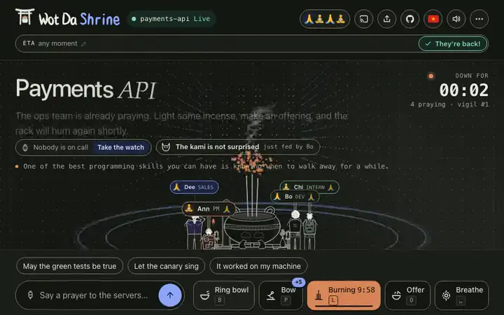
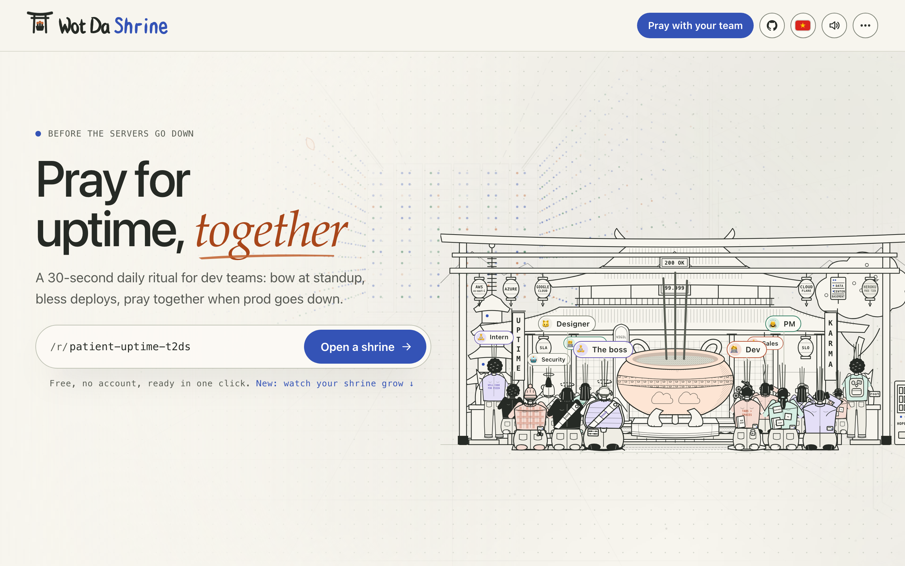
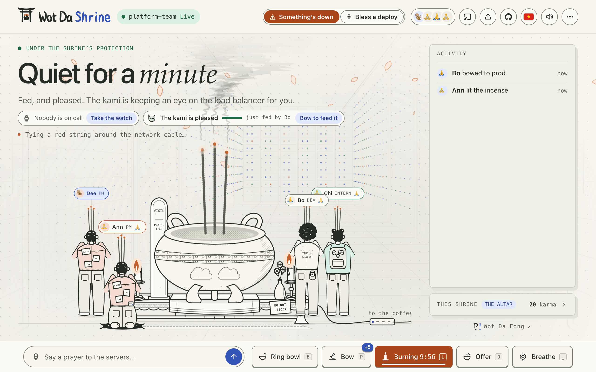
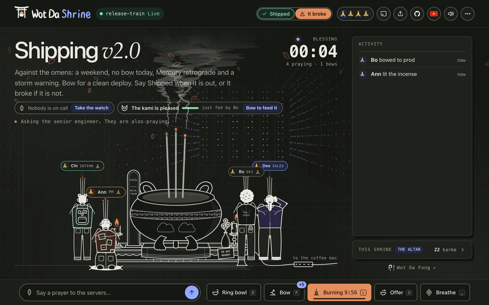
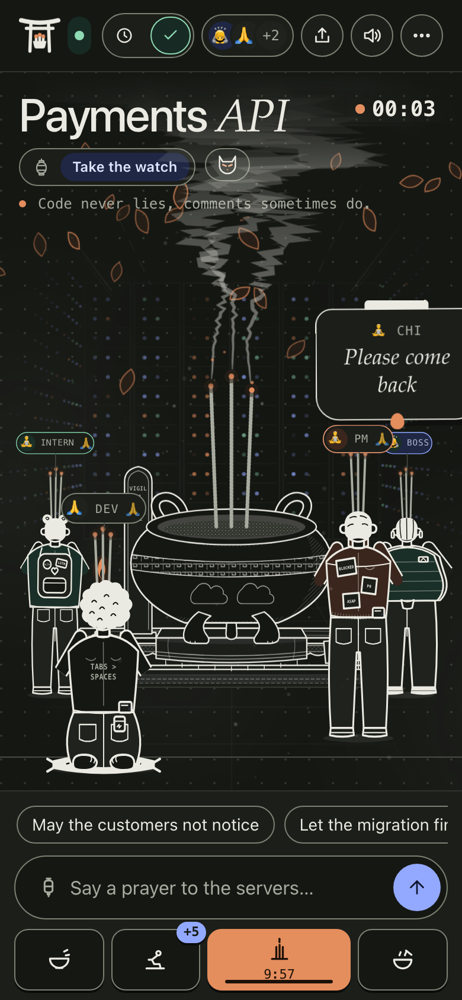
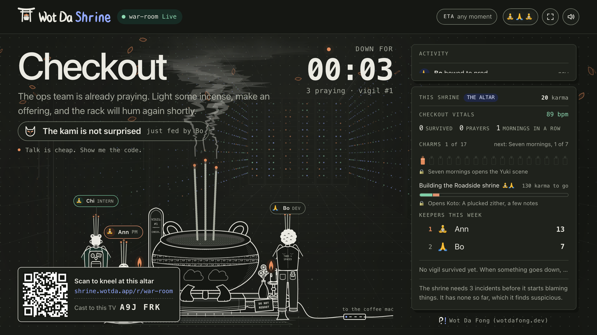

# Wot Da Shrine 🪔

[](https://github.com/fongfan999/wot-da-shrine/actions/workflows/ci.yml)
[](https://shrine.wotda.app/r/demo)

A shrine your team keeps so the servers stay up, and prays at when they
don't. Open one, send the link to your teammates, and bow every morning, bless
every deploy, keep the kami fed and count the days without an incident, all in
real time on one shared altar. When something goes down anyway, the vigil
opens and the whole team prays through it: incense, the bowl, bows, offerings
and prayers to the rack.

Inspired by every "I haven't been able to reach the server for an hour" thread,
and the classic photo of sysadmins praying to a rack with incense. A
[Wot Da Fong](https://wotdafong.dev/) project.

Open source at [github.com/fongfan999/wot-da-shrine](https://github.com/fongfan999/wot-da-shrine).
Issues and pull requests are welcome.

Built with [Vite](https://vite.dev), [GSAP](https://gsap.com) and the Web Audio
API, running on [Cloudflare Workers](https://developers.cloudflare.com/workers/)
with a [Durable Object](https://developers.cloudflare.com/durable-objects/) per
shrine.

**[Open a shrine](https://shrine.wotda.app/new)** · [Try the demo](https://shrine.wotda.app/r/demo) · [Read the guide](docs/README.md)

<p align="center">
  <a href="https://shrine.wotda.app/r/demo"></a>
</p>

## How it works

Open [shrine.wotda.app/new](https://shrine.wotda.app/new) (or `/new?name=Prod is down`) and
send the link to the team. Everyone who opens it kneels at the same altar: one Durable
Object per room keeps who is here, the incense, the karma, the prayers and the vigil, and
every action reaches everyone in real time. `/r/demo` is the public demo, and `?tv=1` turns
any shrine into the screen on the war-room wall. More in
[How it works](docs/how-it-works.md).

<p align="center">
  
</p>

## Days without an incident, and the kami

Most days nothing is down, so the heading counts the days without an incident, and the
kami, the spirit of the shrine, wants feeding: anything done at the altar feeds it, and left
alone it goes hungry. It watches the services you name for it and reads today's forecast,
and the shrine draws its own superstitions from its history. More in
[Days without an incident](docs/quiet-days.md).

<p align="center">
  
</p>

## A vigil, not a visit

When something goes down, someone says so and the vigil opens: the heading counts how long,
the team kneels together, and **They're back!** ends it with bells and the cast of who
helped. Around it, the everyday: bless a deploy against the omens, hold the watch, make the
morning bow, raise the shrine through six levels, earn charms, and open new sounds and
scenes as it grows. More in [Vigils](docs/vigils.md),
[Deploys and the watch](docs/deploys-and-the-watch.md),
[Standing, together and charms](docs/standing-and-together.md) and
[Sounds and scenes](docs/sounds-and-scenes.md).

<table>
  <tr>
    <td width="62%"></td>
    <td></td>
  </tr>
  <tr>
    <td>Blessing a deploy against the omens</td>
    <td>A vigil on a phone</td>
  </tr>
</table>

<p align="center">
  
  <br><sub><code>?tv=1</code>: the war-room wall, with a code to kneel from a phone</sub>
</p>

## Straight from your alerting

Every shrine has a webhook: a firing alert opens the vigil, and a resolved one says the
servers are back. It reads what Alertmanager, Grafana, PagerDuty, Opsgenie, Statuspage,
Better Stack, Datadog and UptimeRobot already send, and anything else can say it plainly:

```bash
curl -X POST "$HOOK" -H 'Content-Type: application/json' -d '{"status":"down","title":"Payments API"}'
```

More in [Straight from your alerting](docs/alerting.md).

## Notifications

Web Push, with nothing in between: a phone hears when something goes down and when it is
back, when the watch is handed to it, when the kami is hungry, and a nudge to keep a run of
morning bows. More in [Notifications](docs/notifications.md).

## Features

- Link previews that say what the room is doing right now, a share card, the vigil as
  Markdown for the retro, and a README badge like the one above: [Sharing](docs/sharing.md)
- The congregation at the altar, prod's vitals, the offering tray, bowl combos, light and
  dark, a sound mixer for the room, keyboard shortcuts: [Features](docs/features.md)

## URL parameters

`?title=`, `?eta=`, `?mix=` and the rest seed a new room, or set how a page looks:
[URL parameters](docs/url-parameters.md).

## Develop

```bash
npm install
npm run dev        # the pages, the Worker and its Durable Objects in workerd, http://localhost:5173
npm test           # the Worker and its shrines over real sockets, a few seconds
npm run test:page  # the pages in a real browser against the Worker (once: npx playwright install chromium)
npm run check      # what CI runs on every pull request: size budget, tests, build
node scripts/screenshots.js  # retakes the README's pictures (docs/media/) from the real pages
```

Node 22.12 or newer. [CONTRIBUTING.md](CONTRIBUTING.md) says where things go and how to
send a change; [ARCHITECTURE.md](ARCHITECTURE.md) how it all fits together.

## Deploy

```bash
npx wrangler login # once
npm run deploy
```

It deploys to https://shrine.wotda.app as a Workers custom domain (the
`wotda.app` zone must be on the same Cloudflare account). The
`*.workers.dev` URL and preview URLs are turned off in `wrangler.jsonc`. Every push to
`main` deploys too, through Cloudflare Workers Builds.

## Project layout

Where each part lives, what travels between the page and the shrine, and the life of an
action: [ARCHITECTURE.md](ARCHITECTURE.md).

## License

[O'Saasy](https://osaasy.dev/): MIT-style, except you may not offer this software as a competing hosted or SaaS service. See [LICENSE](LICENSE).
